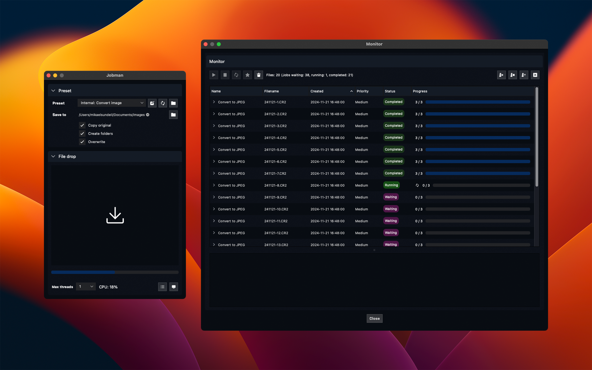

#  Jobman: Batch Processing

[](#resources-and-acknowledgments)

Jobman is a macOS and Windows application for processing files with JSON presets.
A preset defines commands, options, output paths, and task dependencies. Drop
files or folders to create jobs, then inspect their status and logs in Monitor.



[Mac App Store](https://apps.apple.com/se/app/jobman-batch-processing/id6738392819?l=en-GB&mt=12)

- [Quick start](#quick-start)
- [Preset format](#preset-format)
- [Preset fields](#preset-fields)
- [Option fields](#option-fields)
- [Task fields](#task-fields)
- [Template variables](#template-variables)
- [Validation and errors](#validation-and-errors)
- [Monitor](#monitor)
- [MCP server](#mcp-server)
- [Building](#building)
- [Testing](#testing)
- [UI styling](#ui-styling)
- [Resources and acknowledgments](#resources-and-acknowledgments)

## Quick start

1. Select a preset and an existing **Save to** directory.
2. Set its options. **Copy original** preserves the input alongside the output;
   **Create folders** creates an output subfolder named after each input file;
   **Overwrite** permits replacing an existing task output.
3. Drop files or folders. File presets apply their wildcard filter and scan
   folders recursively. Large folder drops ask for confirmation. Rejected files
   are reported and do not become jobs; the drop area returns to ready afterward.
4. Open **Monitor** to inspect output, errors, and dependencies or control jobs.

**Max jobs** controls concurrency, not the number of jobs that can be queued.
Folders can contain thousands of files. Command presets display options and a
Submit button instead of a file-drop area. The **MCP** checkbox enables local
agent access and remembers its state across application launches.

## Preset format

Presets are UTF-8 JSON objects stored as `.json` files in the selected preset
folder. Refresh presets after editing. Use the built-in
[Convert image preset](presets/Convert%20image.json) as another example.

This macOS example uses `sips`; Windows presets should specify an executable
available on Windows. Install external tools separately or configure search paths
and environment variables in Preferences.

```json
{
  "id": "convertimage",
  "name": "Convert image",
  "type": "file",
  "filter": "*.jpg;*.jpeg;*.png;*.tiff;*.bmp",
  "options": [
    {
      "id": "quality",
      "name": "JPEG quality",
      "type": "integerslider",
      "value": 80,
      "default": 80,
      "minimum": 0,
      "maximum": 100,
      "flag": "--setProperty formatOptions"
    },
    {
      "id": "width",
      "name": "Thumbnail width",
      "type": "dropdown",
      "value": 400,
      "default": 400,
      "flag": "--resampleWidth",
      "options": [
        { "label": "Small 200px", "value": 200 },
        { "label": "Medium 400px", "value": 400 },
        { "label": "Large 800px", "value": 800 }
      ]
    }
  ],
  "tasks": [
    {
      "id": "01",
      "name": "Convert to JPEG",
      "command": "sips",
      "extension": "jpg",
      "output": "%outputdir%/%outputbase%.%outputext%",
      "arguments": "-s format jpeg %inputfile% --out %task:output%"
    },
    {
      "id": "02",
      "name": "Adjust JPEG quality",
      "command": "sips",
      "extension": "jpg",
      "output": "%outputdir%/%outputbase%.%outputext%",
      "arguments": "%options:quality% %task:input%",
      "dependson": "01"
    },
    {
      "id": "03",
      "name": "Generate thumbnail",
      "command": "sips",
      "extension": "jpg",
      "output": "%outputdir%/%outputbase%_thumbnail.%outputext%",
      "arguments": "%options:width% %task:input% --out %task:output%",
      "dependson": "02"
    }
  ]
}
```

## Preset fields

| Field | Required | Meaning |
| --- | --- | --- |
| `id` | Yes | Nonempty string, unique among presets in the loaded folder. Also identifies saved option settings. |
| `name` | Yes | Nonempty display name. |
| `type` | No | `file` or `command`; omitted or empty means `file`. |
| `filter` | No | Semicolon-separated wildcard patterns, such as `*.jpg;*.png`. Omitted or empty means `*.*` (all files). Whitespace around patterns is trimmed; empty patterns between separators are errors. |
| `description` | No | Descriptive metadata: a string or array of strings. |
| `options` | No | Array of option objects; omit it or use `[]` when no options are needed. |
| `tasks` | Yes | Nonempty array of task objects. |

Names, IDs, and commands must be strings, not JSON numbers or booleans. Field
names are case-sensitive. Unknown fields are rejected to expose spelling errors.

## Option fields

| Field | Required | Meaning |
| --- | --- | --- |
| `id` | Yes | Nonempty string, unique within the preset; referenced by `%options:id%`. |
| `name` | Yes | Nonempty display name. |
| `type` | Yes | One of the control types below. |
| `value` | Yes | Explicit initial value. A `default` never fills a missing `value`. |
| `default` | No | Reset value. If omitted, the explicitly supplied `value` becomes the reset value. |
| `description` | No | Tooltip string. |
| `flag` | No | Command-line flag string, such as `--quality`. |
| `flagonly` | No | Emit the flag alone. Requires a nonempty flag. Default `false`. |
| `valueonly` | No | Emit the value without a flag. Default `false`; cannot be combined with `flagonly: true`. |
| `minimum`, `maximum` | No | Numeric controls only; default to 0 and 100. Both current and reset values must lie within the range. |
| `toggle` | No | Optional enable-checkbox label. A nonempty label initially disables the option until enabled. |
| `options` | Dropdown only | Required nonempty array of `{ "label": "Display text", "value": ... }` choices. Labels are optional strings; values are required and unique. |

Supported control types:

| Type | `value` and `default` |
| --- | --- |
| `integer`, `integerslider` | Signed 32-bit integers; integer strings such as `"80"` are also supported. Fractional values are rejected. |
| `double`, `doubleslider` | Finite numbers or numeric strings such as `"1.25"`. A double slider requires a positive, finite range. |
| `checkbox` | JSON booleans or `"true"` / `"false"` strings; these strings are normalized to booleans. |
| `dropdown` | Strings, numbers, or booleans that match a listed choice value. Both `value` and `default` must match values, not display labels. |
| `text`, `label`, `openfile`, `savefile` | Strings. Use `"value": ""` for an initially empty field. `label` displays static text. |

Legacy numeric-string dropdown selections, such as `"400"` matching a numeric
choice `400`, remain supported. Prefer consistent JSON types in new presets.
Nulls, arrays, and objects are not option values. Checkbox values are values, not
implicit enable switches: `toggle` controls whether an option is emitted.

Saved preferences can override a preset's initial option values and enabled
states when it is loaded. Changing an option interactively does not rewrite the
preset file. Resetting options uses `default`.

## Task fields

| Field | Required | Meaning |
| --- | --- | --- |
| `id` | Yes | Nonempty string, unique within the preset. Tasks are sorted by string ID. |
| `name` | Yes | Nonempty display name. |
| `command` | Yes | Nonempty executable name or path. Put arguments in `arguments`. |
| `extension` | Yes | Nonempty output extension, usually without a leading dot, such as `jpg`. Supports input path variables. |
| `output` | Yes | Nonempty task output path or template. Jobs require a tracked output path. |
| `arguments` | Yes | Nonempty argument template. Repeated space separators are ignored. |
| `startin` | No | Child process working-directory template. Empty uses the inherited directory; it does not change Jobman's directory. |
| `dependson` | No | ID of one preceding task. Empty means independent. |
| `exclusive` | No | Boolean or `"true"` / `"false"` string. Serializes jobs marked exclusive that share the same command string, through the existing queue. Default `false`. |
| `documentation` | No | Array of help strings. |

Dependencies must exist, must not refer to the task itself, and must not form a
cycle. A dependency must sort before its dependent by **string** ID, preserving
Jobman's existing submission order. Prefer zero-padded IDs such as `01`, `02`,
`03`; `10` sorts before `2`. JSON array order does not set execution order.
Nonexclusive jobs can still run concurrently with exclusive jobs; mark every
job in a command group exclusive when that group must serialize.
Dependent jobs run only after their required job succeeds. Different input files
can process concurrently according to Max jobs, priorities, and exclusivity.

## Template variables

| Variable | Meaning |
| --- | --- |
| `%inputdir%` | Original input's directory. |
| `%inputfile%` | Original input's full path. |
| `%inputext%` | Original input's extension. |
| `%inputbase%` | Original input's complete base name, excluding the final extension. |
| `%outputdir%` | Calculated output directory, including a per-input folder when enabled. |
| `%outputfile%` | Calculated output filename before applying the task's custom `output` template. |
| `%outputext%` | Task output extension. |
| `%outputbase%` | Calculated output base name. |
| `%options:id%` | Option flag and value, or the selected flag-only/value-only form. |
| `%task:output%` | This task's expanded `output` path; usable in `arguments` only. |
| `%task:input%` | The dependency's expanded output path; usable in dependent-task `arguments` only. Use `%inputfile%` for an independent task's input. |

Input/output path variables work in command, output, arguments, and startin.
Extension supports input variables only. In command presets, input path variables
are derived from the task output template rather than a dropped file; use
explicit paths or option values where possible.

Undefined option references and unsupported or unterminated reserved placeholders
are errors. Each argument token, command, output, or startin field supports one
distinct option reference; separate different option placeholders with spaces in
arguments. Flag-only options must occupy a whole argument or field. Disabled
options omit their containing argument/field, so use standalone argument tokens
for optional flags.

Arguments use Jobman's template expansion and space splitting, **not a shell
parser**. Quote characters, shell redirection, and shell pipelines do not add
shell semantics. Paths substituted from a file placeholder remain one argument,
including embedded spaces; keep each argument placeholder in its own token.

## Validation and errors

An invalid preset is skipped and its error is shown in the preset-loading report.
Other valid presets can still load. Errors identify the preset file, the option
or task (using one-based positions and its ID when available), the field, and the
reason. JSON syntax errors include line, column, and byte offset; columns count
UTF-8 bytes.

Validation covers required fields and types, unknown fields, duplicate IDs and
choice values, dropdown membership, numeric bounds, boolean values, task
references, dependency ordering/cycles, and supported placeholders. A failed
read exposes no partial or previously loaded definition. Missing executables,
inaccessible runtime output paths, and conversion failures are reported in job
logs at execution time rather than guessed from the machine parsing the preset.

For example, a dropdown default `999` with choices `200` and `400` reports:

```text
options[1] ("width").default: 999 is not a listed choice. Allowed values: 200, 400.
```

## Monitor

Monitor shows Name, Filename, Time, Priority, Status, and Progress. Time shows
creation time while waiting, elapsed time while running, and final duration when
execution finishes. Tooltips include creation/start/finish timestamps. Metrics
show file/job totals, selected jobs, and outcomes including dependency failures.

Start resumes stopped jobs; Stop requests termination; Restart runs eligible
finished jobs again. Priority, removal, filtering, and dependency views use the
existing queue. Restart logs show **Restarted**, the timestamp, and **Filename**
with its size. Captured stdout/stderr are decoded as UTF-8. The file-browser menu
lists **Input file**, then **Output file** (Show in Finder on macOS).

## MCP server

Enable **MCP** beside Max jobs, or launch `Jobman --mcp`. The server is initially
off, binds only to IPv4 loopback, and normally listens at
`http://127.0.0.1:37652/mcp` (Stageviz uses 37651). The checkbox and selected port
are remembered across launches. An occupied-port startup error leaves the switch
unchecked and clears automatic startup; fix the error and check it to retry.
**Help → MCP Server** opens the [MCP guide](docs/MCP.md) on GitHub.

```sh
Jobman --mcp --mcp-port 37652
Jobman --mcp --mcp-port 0
codex mcp add jobman --url http://127.0.0.1:37652/mcp
```

Port `0` chooses an available port; the checkbox tooltip and startup log show its
endpoint. Explicit command-line startup takes precedence over the remembered
port. The macOS executable is `Jobman.app/Contents/MacOS/Jobman`.

The server supports stateless MCP Streamable HTTP JSON requests: `initialize`,
`ping`, `tools/list`, `tools/call`, and notifications. Its named tools are:

| Capability | Tools |
| --- | --- |
| Application and preset state | `jobman_get_status`, `jobman_list_presets`, `jobman_select_preset` |
| Output location and preferences | `jobman_set_output_directory`, `jobman_save_preferences` |
| Submit files/folders | `jobman_submit_files` |
| Enumerate, inspect, and control jobs | `jobman_list_jobs`, `jobman_get_job`, `jobman_control_job` |
| Read and answer application dialogs | `jobman_get_dialog`, `jobman_respond_dialog` |
| Inspect and operate Qt widgets/actions | `jobman_get_qt_state`, `jobman_qt_action` |
| Capture actual widgets as PNG images | `jobman_capture_widget` |

Submissions use the selected preset and normal file-drop/queue path. There is no
MCP file-count or total-job cap; folders can contain thousands of files. Listings
are paginated: follow `nextCursor` until empty. The page size defaults to 100 and
can be increased. HTTP request-size bounds still apply to explicit path arrays.

Submission acceptance means scanning started, not that files passed validation or
jobs completed. Inspect dialogs, wait for submission readiness, enumerate the new
UUIDs, and inspect final job states/logs. Drive requests from an **external
controller**: handlers execute on Jobman's Qt thread. The Qt tools provide named
inspection/actions rather than an embedded Python interpreter. See
[docs/MCP.md](docs/MCP.md) for schemas, pagination, async workflows, client setup,
and screenshot examples; agents should read it before operating Jobman.

## Building

Dependencies are Qt 6 Core, Concurrent, Gui, Widgets, and Network, plus a C++17
compiler and CMake 3.27 or later. Set `THIRDPARTY_DIR` to the **installed dependency
prefix** containing `lib/cmake/Qt6/Qt6Config.cmake`, matching the configuration
and architecture. Build scripts report missing tools and environment variables.

On macOS, the Xcode build script retains its CMake **3.27.x** requirement:

```sh
export THIRDPARTY_DIR="/path/to/dependency/install/prefix"
./build_app.sh debug --target=13
./build_app.sh release --target=13
```

Use `--github` for a deployed DMG or `--appstore` for an App Store package;
signing/provisioning require the corresponding identities and profiles. Use
`DYLD_IMAGE_SUFFIX=_debug` only with Debug Qt frameworks; unset it for Release.

On Windows, the script discovers installed Visual Studio/Build Tools and a matching
CMake generator. Install the Desktop development with C++ workload and Windows
SDK, or pass `--cmake_generator=NAME` for another configured toolchain.

```bat
set "THIRDPARTY_DIR=C:\path\to\dependency-install-prefix"
call build_app.bat Debug
call build_app.bat Release --deploy
```

Use separate configuration-matched dependency prefixes for Debug and Release.

## Testing

After configuring a matching build, run:

```sh
./test_app.sh release --build-dir build.release
./test_app.sh debug --build-dir build.debug
./test_app.sh release --build-dir build.release --filter 'jobman.preset_'
```

Windows uses `test_app.bat Debug` / `Release` with equivalent runner options.
Python 3 is required. Results, build logs, JSON summaries, and JUnit reports are
saved under `build.test-results/`.

Tests cover preset validation and README examples, option expansion and command
chains, process output/UTF-8/working directories, queue scheduling and signals,
monitor state, file-drop recovery, MCP transport and persistence, thousands of
input files, complete pagination, and UI themes/icons. GUI tests use isolated
preferences. See [CTest/README.md](CTest/README.md) for direct CMake/CTest commands
and comparison against the original queue implementation.

## UI styling

Views use the shared `ui.h` / `ui.cpp` palette, fonts, semantic icons, disabled
states, and DPI-aware pixmap cache. External `Resources/App.css` overrides the
embedded stylesheet; it applies across windows and dialogs. The Debug menu can
reload it. See [docs/UI.md](docs/UI.md) for role names and view setup.

## Resources and acknowledgments

- [GitHub project](https://github.com/mikaelsundell/jobman)
- [Issues](https://github.com/mikaelsundell/jobman/issues)
- License: BSD-3-Clause; see the SPDX headers in the source files.
- App icon: flaticon.com.
- Qt: Copyright The Qt Company Ltd. and its contributors, under the applicable Qt licenses.
